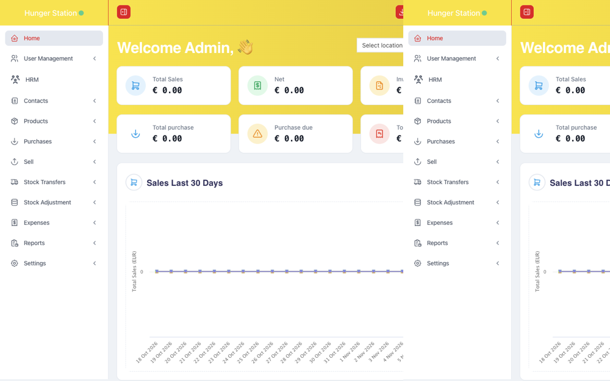
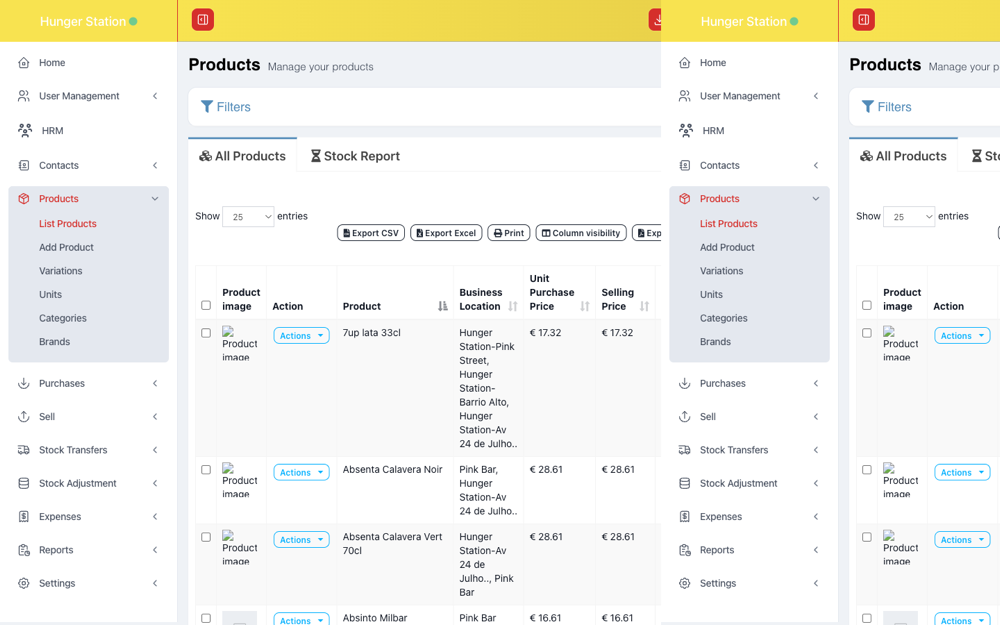
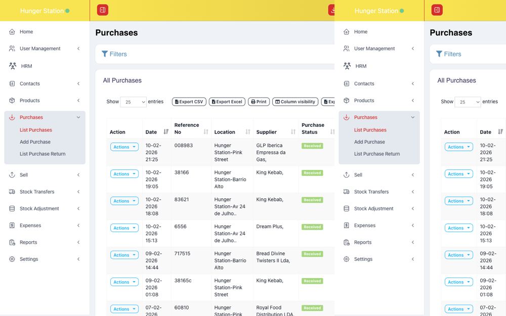
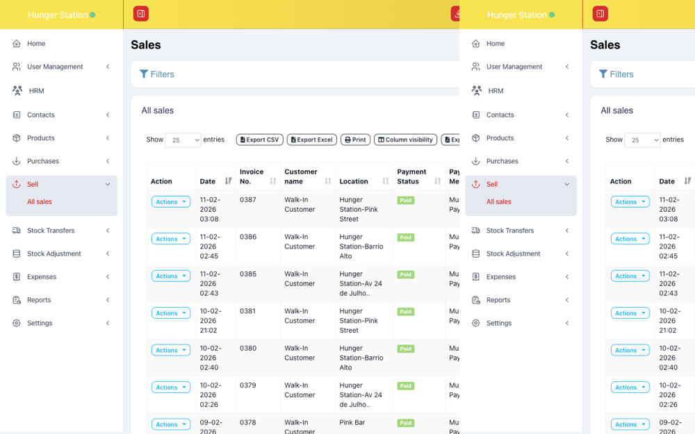
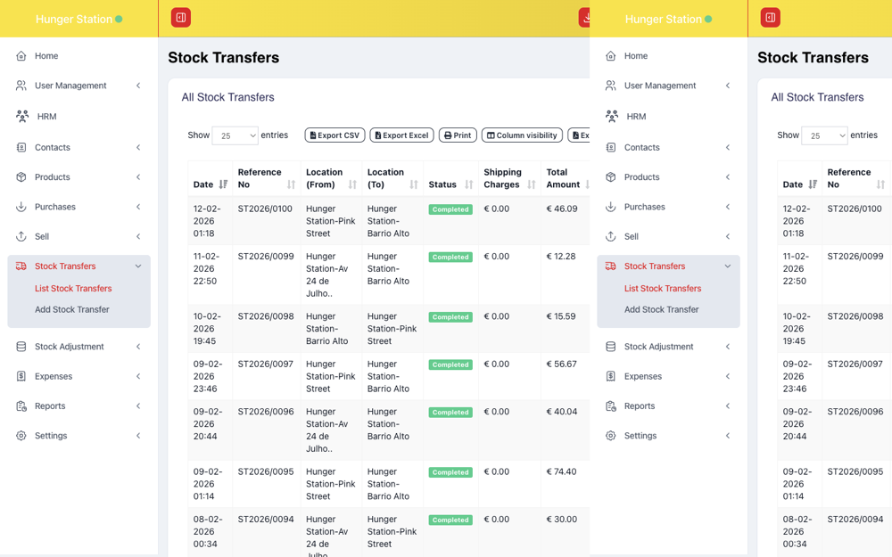
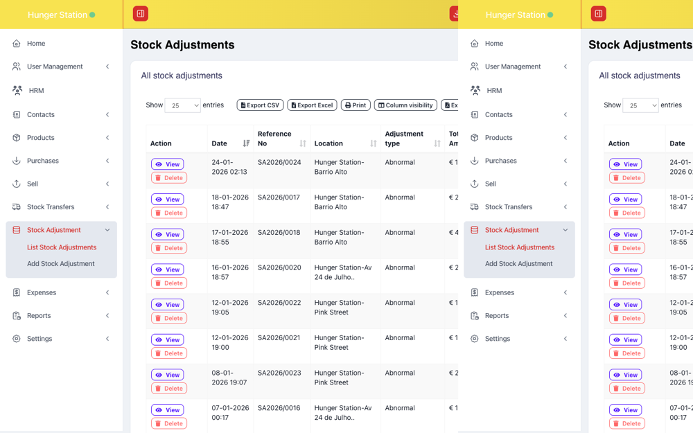
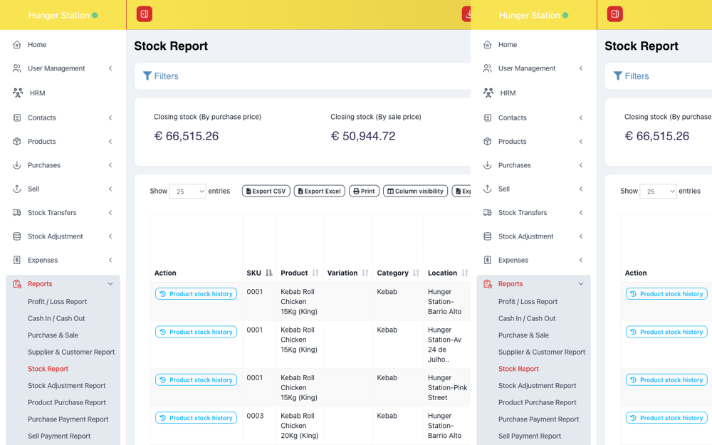

# Inventory Management System (ERP)

Multi-location **Inventory Management System (ERP)** with POS, purchases, stock control, expenses, reporting — plus optional HRM module.

**Live demo:** [hrm.webexert.us](https://hrm.webexert.us)

> Built & optimized by **Muhammad Usman** (Laravel / PHP).

---

## What it is

A full **ERP / inventory** admin panel for retail & multi-branch businesses:

- Manage **products, stock, purchases, sales** across locations
- Track **payments, expenses, profit/loss**
- Run **stock transfers & adjustments**
- Export reports (CSV / Excel / PDF)
- Control access with **users, roles & permissions**
- Optional **HRM** (leave, attendance, payroll)

---

## Complete feature list

### 1) Dashboard & analytics
- KPI cards: total sales, net, invoice due, sell return, purchases, purchase due, purchase return, expenses
- Sales charts (last 30 days / financial year) by location
- Sales & purchase payment dues
- Product stock alerts
- Sales orders overview
- Location + date range filters

### 2) User management
- Users CRUD
- Roles & permissions (ACL)
- Sales commission agents

### 3) Contacts
- Customers & suppliers
- Import contacts
- Contact-linked purchases/sales

### 4) Products (inventory master)
- List / add / edit products
- Product images, SKU, purchase & selling price
- Variations, units, categories, brands, tax
- Multi-location product assignment
- Bulk actions: add/remove location, deactivate, delete
- Filters + export CSV / Excel / PDF / print

### 5) Purchases
- Purchase orders list & create
- Purchase status & payment status
- Supplier + location filters
- Purchase returns
- Add payment against purchases

### 6) Sell / POS
- All sales list
- Create sale / POS flow
- Payment status & method filters
- Date range & location filters
- Sell returns (as applicable)

### 7) Stock transfers
- Transfer stock between locations
- Status updates
- List / add transfers + export

### 8) Stock adjustments
- Manual stock increase/decrease
- Adjustment history + export

### 9) Expenses
- Expense list & create
- Expense categories
- Location / date filters

### 10) Reports
- Profit / Loss
- Cash In / Cash Out
- Purchase & Sale
- Supplier & Customer report
- Stock Report
- Stock Adjustment report
- Product Purchase report
- Purchase Payment report
- Sell Payment report
- Expense report
- Sales Representative report
- Activity log

### 11) Settings
- Business settings & branding
- Business locations
- Invoice / tax / barcode settings
- System configuration

### 12) HRM module (add-on)
- HR dashboard
- Leave types & leave requests
- Attendance, shifts, clock in/out
- Holidays, departments, designations
- Payroll & loans

---

## Tech stack

| Layer | Technology |
|-------|------------|
| Backend | **PHP 8**, **Laravel 9** |
| Auth / ACL | Session auth, **Laravel Passport**, **Spatie Permission** |
| Architecture | Modular (**nwidart/laravel-modules**) |
| UI | Blade, AdminLTE, Bootstrap, jQuery, **Yajra DataTables** |
| Export | DomPDF, Maatwebsite Excel, mPDF |
| Database | **MySQL** |

---

## Screenshots

### ERP dashboard



### Products / inventory



### Purchases



### Sales



### Stock transfers



### Stock adjustments



### Stock report



---

## Local setup

```bash
composer install
cp .env.example .env
php artisan key:generate
# set DB_* in .env
php artisan migrate
php artisan serve
```

---

## Author

**Muhammad Usman** — Full-Stack Developer (Laravel / PHP)  
[GitHub](https://github.com/usman-wurfel) · [LinkedIn](https://www.linkedin.com/in/muhammad-usman-ali-311418221)
